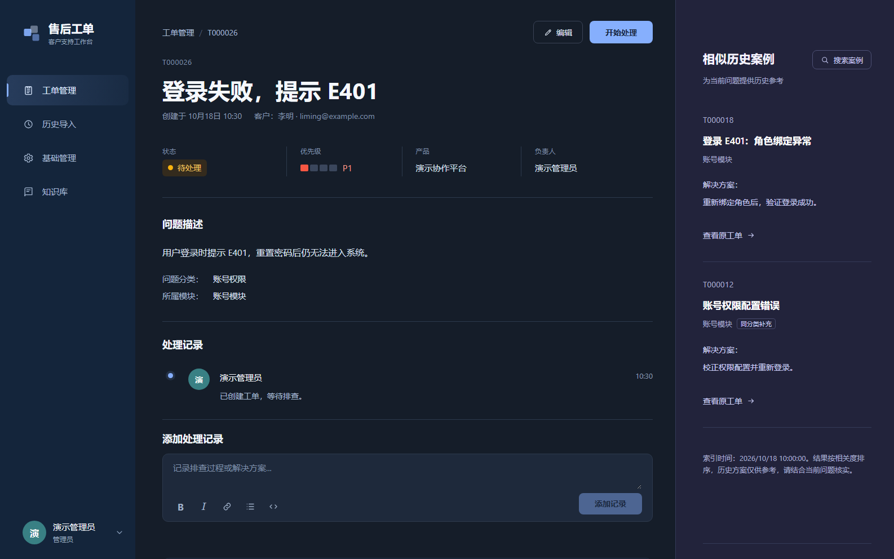

# 工作台界面改版

> 2026-10-18 流畅度更新：最终第八部分现已采用出处抽屉、列表状态保留、按需加载及等待反馈。最新行为、跟写顺序和验证范围见 [流畅度优化说明](18-工作台流畅度优化.md)。本页早先的新标签行为和单包体积记录为历史版本。

本部分按确认的设计图重做工单详情页，只改前端呈现和交互承载，不改工单状态机、权限、数据库和接口语义。



图片使用示例数据，只用于说明布局；实际页面读取 PostgreSQL 和检索接口。相似案例卡片是在点击“搜索案例”后出现，页面不会打开工单时自动调用检索。

## 改版范围

- 新增工作台壳层：左侧导航、底部用户菜单、主区滚动。
- 工单详情页改为“主区 + 右侧参考栏”，保留原来的开始处理、解决方案、关闭、处理记录、AI 建议。
- 相似案例和知识依据改为右侧栏卡片；仍然由客服手动点击检索。
- 处理记录支持少量 Markdown：加粗、斜体、链接、列表、行内代码。
- 相似案例响应增加 `module_id`，前端显示案例所属模块。

不包含：附件上传、HTML 富文本、自动检索、自动改状态、邮件发送、统计看板。

## 页面结构

```text
┌──────────────┬──────────────────────────────────┬──────────────────┐
│ 售后工单      │ 工单管理 / T000026   [编辑][开始处理] │ 相似历史案例 [搜索] │
│ 客户支持工作台 │ T000026                           │ ...案例卡片...    │
│ ▸ 工单管理    │ 登录失败，提示 E401                │                  │
│   历史导入    │ 创建于 ... · 客户 ...              │ 相关知识依据      │
│   基础管理    │ 状态 | 优先级 | 产品 | 负责人       │ [检索知识]        │
│   知识库      │ 问题描述 / 问题分类 / 所属模块      │                  │
│              │ 解决方案（已解决/已关闭时显示）      │                  │
│              │ 处理记录（时间线）                  │                  │
│              │ 添加处理记录 [工具栏] [添加记录]     │                  │
│ 用户 / 退出   │ AI 处理建议                         │                  │
└──────────────┴──────────────────────────────────┴──────────────────┘
```

设计图的“影响范围”在现有数据中没有对应字段，页面显示为“问题分类”；“客户”信息图里没有，但回复客户需要，放在创建时间后面。附件按钮不实现，因为后端没有附件接口。

## 状态与按钮流转

| 当前状态 | 顶栏按钮 | 动作 |
|---|---|---|
| 待处理 pending | 编辑、开始处理 | `POST /api/tickets/{id}/start` → 处理中 |
| 处理中 processing | 编辑、标记已解决 | 弹窗填写解决方案 → `POST /resolve` → 已解决 |
| 已解决 resolved | 编辑、关闭工单 | 勾选“已在系统外完成客户回复” → `POST /close` → 已关闭 |
| 已关闭 closed | 无 | 只读，不显示记录输入框 |

其他操作：

- 编辑：未关闭可进入 `/tickets/{id}/edit`，保存后回详情，状态不变。
- 添加记录：`POST /api/tickets/{id}/records`，空内容不提交；失败保留输入。
- 搜索案例：`POST /api/tickets/{id}/similar`，手动触发；加载中禁用。
- 检索知识：`POST /api/tickets/{id}/knowledge`，手动触发。
- 查看原工单：在当前页面的只读抽屉加载工单详情，原页面草稿保留。知识文档同理。
- AI 建议：仅在待处理/处理中生成或采用；采用后只写处理记录，不改状态、不发邮件。

状态变化仍由后端独立接口保证，前端不通过编辑接口修改状态。

## 关键实现

### 1. 壳层与导航

`App.vue` 根据登录状态和 `route.meta.public` 选择独立页面或工作台：

```vue
const isStandalone = computed(() => !auth.user || Boolean(route.meta.public))
const isTicketDetail = computed(() => /^\/tickets\/\d+$/.test(route.path))
```

`AppSidebar.vue` 负责导航和用户菜单。历史导入、基础管理只对管理员显示；知识库所有登录用户可见；退出登录清空内存中的 token 并回到 `/login`。

### 2. 详情页状态按钮

`TicketDetailView.vue` 根据当前状态给出一个主按钮：

```ts
const primaryAction = computed<{ label: string; run: () => void } | null>(() => {
  if (!ticket.value) return null
  if (ticket.value.status === 'pending') return { label: '开始处理', run: start }
  if (ticket.value.status === 'processing') return { label: '标记已解决', run: openResolve }
  if (ticket.value.status === 'resolved') return { label: '关闭工单', run: openClose }
  return null
})
```

“开始处理”和“添加记录”成功后用接口返回的完整详情替换页面；遇到 409 时先刷新详情，再显示后端错误，让按钮跟随真实状态，而不是假装成功。

### 3. 记录编辑器与 Markdown

`NoteComposer.vue` 在工具栏插入 Markdown 标记，不引入富文本编辑器。`utils/markdown.ts` 先转义用户内容，再生成有限的固定标签：

```ts
let html = text.replace(/[&<>"']/g, char => escapeMap[char] ?? char)
html = html.replace(/`([^`]+)`/g, ...)
html = html.replace(/\*\*([^*]+)\*\*/g, '<strong>$1</strong>')
```

链接只接受 `http://` 或 `https://`。时间线用 `v-html` 展示处理后的内容，原始文本不会直接当 HTML 执行。

### 4. 相似案例和知识依据

`SimilarCases.vue` 保留原来的索引未就绪、失效候选、同分类补查提示；卡片不显示原始排序分数，避免把分数理解成正确率。相似案例接口新增 `module_id`：

```python
class SimilarCase(BaseModel):
    ...
    module_id: int
```

前端用基础配置里的模块名显示“账号模块”，只在同分类补查时额外显示标签。

### 5. 主题

颜色集中在 `style.css` 的 CSS 变量中，并覆盖 Element Plus 的深色变量。主区背景 `#151d29`，侧栏 `#14253b`，右栏 `#22233b`，主按钮 `#86affd`。窄屏只做右栏下沉和侧栏收窄，不单独设计移动端。

## 文件变化

| 操作 | 文件 |
|---|---|
| 修改 | `frontend/src/App.vue`（源码见本教程对应代码块） |
| 修改 | `frontend/src/main.ts`（源码见本教程对应代码块） |
| 修改 | `frontend/src/style.css`（源码见本教程对应代码块） |
| 修改 | `frontend/src/views/TicketDetailView.vue`（源码见本教程对应代码块） |
| 修改 | `frontend/src/views/HealthView.vue`（源码见本教程对应代码块） |
| 修改 | `frontend/src/components/SimilarCases.vue`（源码见本教程对应代码块） |
| 修改 | `frontend/src/components/KnowledgeMatches.vue`（源码见本教程对应代码块） |
| 修改 | `frontend/src/api/analysis.ts`（源码见本教程对应代码块） |
| 新增 | `frontend/src/components/AppSidebar.vue`（源码见本教程对应代码块） |
| 新增 | `frontend/src/components/AppIcon.vue`（源码见本教程对应代码块） |
| 新增 | `frontend/src/components/StatusBadge.vue`（源码见本教程对应代码块） |
| 新增 | `frontend/src/components/PriorityMeter.vue`（源码见本教程对应代码块） |
| 新增 | `frontend/src/components/TicketTimeline.vue`（源码见本教程对应代码块） |
| 新增 | `frontend/src/components/NoteComposer.vue`（源码见本教程对应代码块） |
| 新增 | `frontend/src/utils/time.ts`（源码见本教程对应代码块） |
| 新增 | `frontend/src/utils/markdown.ts`（源码见本教程对应代码块） |
| 修改 | `backend/app/modules/analysis/router.py`（源码见本教程对应代码块） |

`package.json` 没有新增依赖；Markdown 渲染用项目内的小工具完成。后端没有数据库迁移。

最终界面全部源码及固定写法说明已补入 [逐文件讲解](09-逐文件代码与讲解.md) 的“最终工作台界面”一节。图中为此前的示例渲染；后续流畅度更新使用出处抽屉，文字以当前代码为准。

## 运行与检查

前端：

```bash
cd frontend
npm ci
npm run typecheck
npm run build
```

本次在 Node 24 下执行：`npm run typecheck` 通过，`npm run build` 通过。构建仍提示单个 JS 包超过 500 kB，属于现有 Element Plus 引入方式带来的体积提示，退出码为 0。

后端改动只有相似案例响应字段，已执行语法检查；完整 `pytest` 需要 `.env.test`、PostgreSQL 和临时索引，本次没有在无数据库环境执行，验收时按原教程步骤运行。

## 手工验收

1. 打开待处理工单：左侧栏、标题、四列元信息、处理记录、右侧案例栏显示正常。
2. 点击开始处理：状态变为处理中，主按钮变为标记已解决，时间线出现状态记录。
3. 点击标记已解决：弹窗必须填写方案；保存后出现解决方案卡片，主按钮变为关闭工单。
4. 关闭时未勾选确认不能提交；关闭后编辑和记录输入框消失。
5. 点击搜索案例：加载中按钮禁用；返回最多 5 条；索引未建立或模型失败显示准确错误。
6. 添加记录：空内容不能提交；成功追加；失败不清空。
7. 先填写一段未提交的记录，再点“查看原工单”：抽屉打开所选工单，关闭后草稿仍在。知识文档也按此方式验证。
8. 管理员可见历史导入、基础管理；客服不可见；知识库入口保留。

登录返回修正还涉及 `frontend/src/router/index.ts`（源码见本教程对应代码块） 和 `frontend/src/views/LoginView.vue`（源码见本教程对应代码块）：未登录时记录目标地址；登录后只允许返回本站已登记的非公开页面，角色权限继续由路由守卫和后端检查。

依赖安装提示：`npm ci` 需要当前依赖对应的 `package-lock.json`。跟写时还没有锁文件，先在 `frontend` 运行 `npm install`；使用参考包配套锁文件时再运行 `npm ci`。
