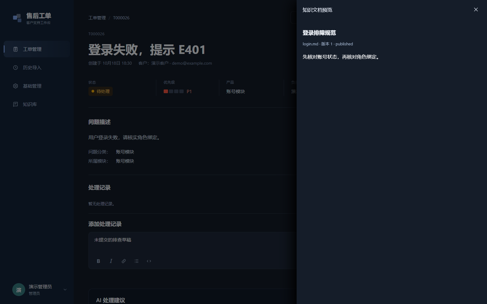

# 工作台流畅度优化与跟写说明

本次更新 `08-evaluation` 最终参考工程，正式工程需要你自己对照跟写。第六、第七部分仍保留学习过程中的版本，最后统一对照第八部分，避免混用同名文件。

## 页面现在怎样操作

- 工单列表返回后保留筛选、页码和滚动位置，同时重新获取数据。退出登录后清除列表缓存。
- 相似案例、知识文档和 AI 引用通过右侧只读抽屉查看，关闭后继续编辑原工单，草稿保留。
- 详情首次加载显示骨架占位。再次检索时保留上一批结果并提示正在更新；失败显示真实错误。
- AI 生成时显示已等待秒数，临时禁止编辑；失败后保留人工修改的方案。秒数不是完成百分比。
- 长案例方案支持展开；系统开启减少动画时，页面减少过渡效果。

## 按这个顺序跟写

完整代码在 [逐文件代码与讲解](09-逐文件代码与讲解.md) 的最终工作台与补充文件章节。

| 文件（位于最终前端 src） | 大白话解释 | 固定写法和可改内容 |
|---|---|---|
| `router/index.ts` | 打开哪个页面，再加载那个页面的代码 | `() => import(...)` 是动态导入写法；路径必须对应文件 |
| `main.ts` 和各 Vue 文件 | 每个页面导入用到的 Element Plus 组件与样式 | 导出名称、样式路径按库约定；增加组件时同时补导入和样式 |
| `App.vue` | 让工单列表暂时留在内存里 | `KeepAlive` 是 Vue 组件；`include` 必须匹配 `TicketsView` 组件名称 |
| `views/TicketsView.vue` | 返回列表时刷新数据，再把滚动位置放回去 | `onActivated`、`nextTick` 是 Vue 接口；筛选项沿用接口字段 |
| `views/TicketDetailView.vue` | 负责详情加载、打开资料抽屉，并把分类传给 AI 面板 | `categories` 属性与子组件声明对应，不能只改一边 |
| `components/SourcePreview.vue` | 共用一个只读窗口查看原工单或知识 | `kind`、`id` 与事件参数一致；展示标题可以改 |
| `components/SimilarCases.vue`、`KnowledgeMatches.vue` | 检索时保留原结果，点击出处通知父页面 | `emit('preview', ...)` 与父页面监听配套；提示文案可以改 |
| `components/AssistancePanel.vue` | 复用父页面分类；等待时计时，失败保留编辑 | `onUnmounted` 清理计时器应保留；不要把等待秒数当真实进度 |
| `style.css` | 控制占位、抽屉、长文本和动画 | 色值、间距可以改；减少动画的媒体查询应保留 |

其余表单页面补充了按需组件导入。`AdminView.vue` 把表格行中的明确字段传给编辑函数，让类型检查能确认参数；业务权限与后端接口未变化。没有新增依赖。

## 检查结果与边界

2026-10-18 在 WSL 运行最终前端 `npm run build`（包含 `npm run typecheck`），以及 `node ../scripts/check_navigation.mjs`。浏览器用真实 Vue 页面和模拟 API 验证列表恢复、退出清空、资料抽屉、草稿保留及 AI 失败状态。

优化前入口 JS 为 1,156.74 kB，优化后为 175.21 kB（构建输出的未压缩大小）。其他页面代码拆为多个文件，因此这不是总下载量，也不是实测加载时间。工单详情的三类基础配置请求从重复的 6 次减少为 3 次。

截图和浏览器检查使用模拟数据。真实 PostgreSQL、Milvus、模型响应时间及业务效果未在本次优化中验证；本次没有改后端，也没有重新运行完整后端测试。

## 自己验收

1. 在列表选条件并切到第二页，滚动后打开详情，再返回，检查条件、页码和位置保留，列表数据有刷新。
2. 写一段未提交记录，查看案例、知识和 AI 引用，关闭抽屉，检查草稿仍在。
3. 修改 AI 方案后重新生成，观察等待提示；服务失败时应显示错误并保留编辑，成功时显示新的生成结果。
4. 退出后重新登录，列表恢复默认条件。刷新浏览器后按 sessionStorage 中的令牌恢复登录，并重新核验身份。
5. 在 WSL 的最终参考工程 `frontend` 目录执行 `npm run typecheck` 和 `npm run build`。
