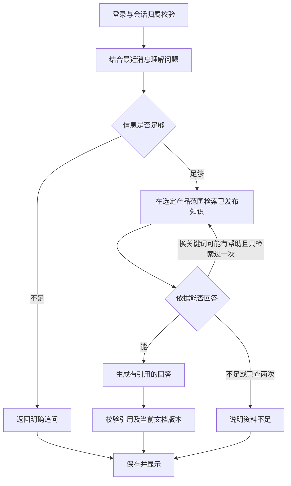

# 第十三部分：知识库问答 Agent

## 1. 这一部分解决什么问题

第七部分围绕某张工单生成建议。本部分增加独立问答入口：选定产品，输入问题，再连续追问。它是 FastAPI 中的业务模块，不需要新开一个后端服务或新增线程池。

第一版只读取知识、生成回答和保存会话，不授予修改工单、发邮件、执行命令的工具。用户需要执行操作时，进入原业务页面并确认。

选 LangGraph 的原因：需要明确控制何时检索、何时追问、何时结束，并且已有模型和知识库函数可以复用。LangGraph 管流程，Embedding 管语义表示，Milvus 管检索，聊天模型管理解和生成；它们不是互相替代关系。

聊天模型通过现有 ChatClient 接入；如果选用 DeepSeek，按其接口配置模型名、地址和密钥，并实测结构化输出。LangGraph 负责本教程的流程控制。

## 2. 一次提问怎么运行

例如“E401 怎么处理？”之后追问“第二步在哪里设置？”，规划节点结合最近对话，形成独立完整的问题，保存在 `resolved_question`。补查时只修改 `query` 检索词，后续判断和回答仍能看到完整问题。模型不能改变会话中选定的产品范围。每一轮重新检索，不把历史助手回答直接当作知识依据。

## 3. 先完成独立流程

阅读同目录 `qa_graph.py`，先运行 README 中的测试。固定规则：

- 每次提问最多检索两次；第二次用于新关键词，不是网络失败重试。
- 有效返回状态为 answered、clarification、insufficient；网络、模型和索引故障通过错误路径返回，不冒充资料不足。
- 每个回答段落都要引用本轮来源；后端只接纳当前检索结果中的 ID。
- 模型 JSON 在边界按 Pydantic 类型校验，不用默认成功掩盖错误。
- 流程只保存一次执行的状态；长期消息保存到 PostgreSQL。

## 4. 按顺序跟写正式工程

| 步骤 | 文件位置（相对项目根目录） | 可观察的结果 |
|---|---|---|
| 1 | backend/app/modules/qa/graph.py | 将独立练习的单轮流程放入正式模块 |
| 2 | backend/app/modules/qa/adapters.py | 复用第六部分的 Embedding、Milvus 和第七部分的 ChatClient，按产品查资料 |
| 3 | backend/app/models.py、backend/migrations/versions/13_qa_conversations.py | 增加会话与消息表，不重建业务库 |
| 4 | backend/app/modules/qa/schemas.py、service.py、router.py、main.py | 检查会话归属，短事务保存、复核引用、记录失败 |
| 5 | frontend/src/api/qa.ts、views/KnowledgeChatView.vue、router/index.ts、components/AppSidebar.vue | 页面提问、刷新恢复、查看来源；导航在工单管理上方 |
| 6 | backend/tests/test_qa_graph.py、test_qa_api.py | 验证流程、会话权限、幂等与失败恢复 |

现在正式工程已经有这些文件。跟写时先理解 `graph.py` 的单轮路径，再理解 `service.py` 为什么要在模型调用前提交 `running`。最后用自己的真实模型和文档验证答案质量。

## 5. 接口约定

| 方法与路径 | 输入 | 返回 |
|---|---|---|
| POST /api/qa/conversations | product_id、title | 会话 ID、选定产品、创建时间 |
| GET /api/qa/conversations | page、page_size | 当前用户自己的会话分页 |
| GET /api/qa/conversations/{id}/messages | page、page_size | 第 1 页取最新消息，每页内部按时间先后显示 |
| POST /api/qa/conversations/{id}/messages | request_id、text | 本轮回答、状态、来源 |

用户 ID 从登录依赖读取。请求不允许传 history 或替换 product_id：历史与范围由服务器从会话取得。请求只允许正文 1—2000 字。当前历史最多保留最近 6 个完整问答对及 6000 个字符；字符数不等于模型 token 数，接真实模型时还要按所选模型的上下文窗口实测。

同一会话只允许一轮正在生成。request_id 是前端为一次发送创建的 UUID；网络结果未知时先读取历史，同一个 UUID 不重复调用模型。相同 UUID 配不同正文返回 409。

## 6. 会话与消息保存规则

会话表 `qa_conversations`：id、owner_id、product_id、title、created_at。

消息表 `qa_messages`：id、conversation_id、request_id、role、content、status、sources（JSONB）、error_code、model、prompt_version、duration_ms、created_at。角色为 user/assistant；回答状态为 running/answered/clarification/insufficient/failed。用户消息状态可固定为 submitted。建立 `(conversation_id, request_id, role)` 唯一约束，以及 assistant/running 的会话级部分唯一索引。

执行顺序：

1. 短事务锁定当前用户的会话，核对产品可用、重复请求和运行状态。
2. 保存用户消息与 running 助手消息，提交；不在模型网络等待期间持有会话写锁。
3. 读取最近完整消息，按上下文预算准备 Question；调用 `await ask(graph, question)`。
4. 模型完成后重新检查引用的发布状态与指纹，再提交回答及引用快照。
5. 创建 running 后，所有退出路径都必须结束本轮状态。模型、索引、超时、引用失效、请求取消、未知异常，都用独立短事务将当前 running 更新为 failed，再返回准确错误或重新抛出原异常。只更新本轮仍为 running 的消息，不能覆盖已经保存的成功回答。

这里对未知异常的处理仅用于释放业务运行状态，不将错误转成默认成功。取消时要让清理事务有机会完成，然后重新抛出取消异常；日志记录 request_id 和错误类别，不记录密钥或完整提示正文。如果数据库自身不可用，清理失败也应留下日志，并由下面的启动恢复处理，不能声称已保存失败结果。

原有教程按单工作进程运行：启动时将旧 running 问答标记为 failed（服务重启中断），由用户明确重新提问。不要只在内存中存 running，否则刷新和重启后无法核查。

## 7. 学完后应该能说明

能解释 State、Node、Edge；能画出一次问答路径；能区分未找到依据与系统故障；能指出回答引用哪一版文档。AI 的引用 ID 合法并不保证回答事实正确，仍需人工或独立数据集评测。

参考：[LangGraph Graph API](https://docs.langchain.com/oss/python/langgraph/graph-api)、[检索 Agent 官方示例](https://docs.langchain.com/oss/python/langgraph/agentic-rag)。
