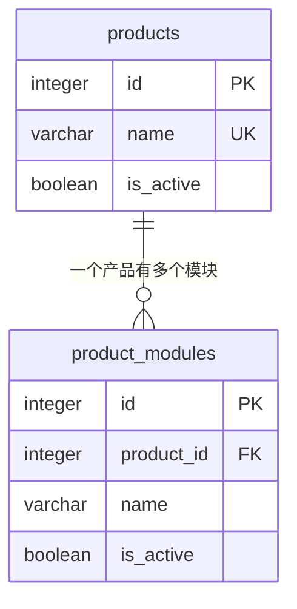
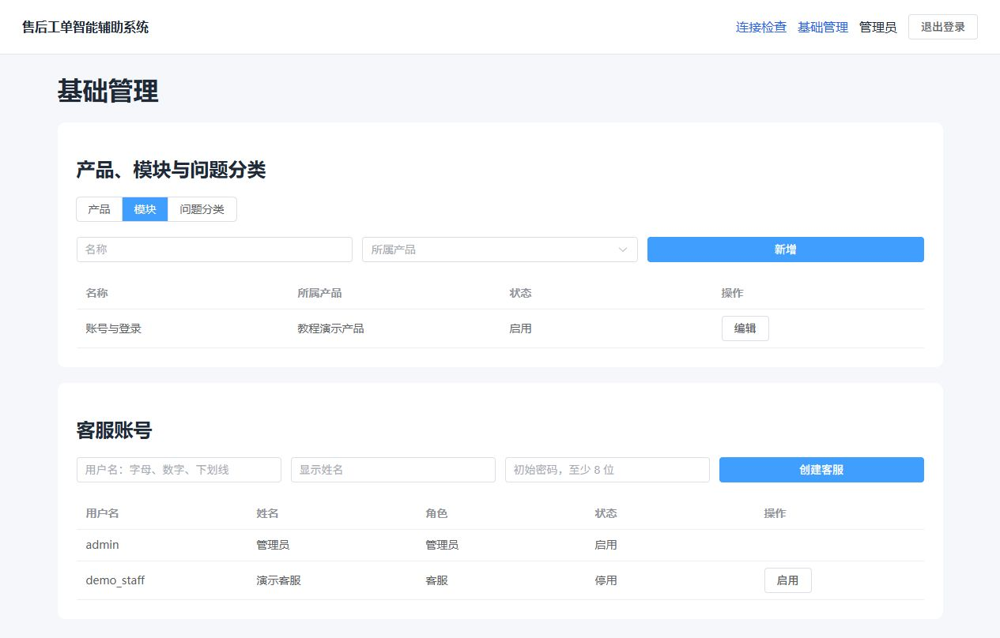

# 第二部分实现与使用说明

本说明对应 `XM` 分支的第二部分：数据库、登录、客服账号和基础配置。项目位置为 `E:\oshino`，WSL 路径为 `/mnt/e/oshino`。旧工程 `E:\xiangmu` 仅保留现有虚拟环境，不作为当前代码目录。

## 1. 现在可以做什么

- 管理员登录，创建、启用和停用客服账号。
- 管理员新增、改名、启用和停用产品、产品模块、问题分类。
- 客服登录后只能使用本阶段开放给普通登录用户的读取接口，不能调用管理员写接口。
- 账号、配置保存到 PostgreSQL，重启后端不会丢失。
- 第一部分的连接检查仍可使用。

本阶段还没有工单表、工单页面、AI、邮件、OCR。客服登录后的首页仍然是连接检查页。

## 2. 先找到账号和密码

**账号用途、配置位置及初始化方式见：[第二部分本机账号（可共享版）](第二部分本机账号.md)。当前电脑的实际初始密码保存在 `.local/第二部分本机账号.md`，该私密文件不进入 Git。**

| 用途 | 用户名 | 密码保存在哪里 | 用于什么地方 |
|---|---|---|---|
| 网页管理员 | `admin` | 本机账号文档 | 登录网页、管理客服和基础配置 |
| 业务数据库用户 | `after_sales` | 本机账号文档、`backend/.env` | 后端程序连接业务库 |
| 测试数据库用户 | `after_sales_test` | 本机账号文档、`backend/.env.test` | 创建隔离测试库并运行测试 |
| 演示客服 | `demo_staff` | 本机账号文档 | 验证客服登录；交付时已停用，管理员可重新启用 |

这些密码分别随机生成，没有公共默认密码。不要把数据库密码当网页登录密码。

`JWT_SECRET` 是签名密钥，保存在 `backend/.env`，不是账号，也不是登录密码。修改它会使之前签发的令牌失效；重启后端后需要重新登录。

`.local/`、`.env`、`.env.test` 已被 Git 忽略，因此本说明可以随代码保存，实际密码不会进入 Git。本机账号文档不会随你以后修改密码自动更新，需要自行同步保管。

## 3. 数据库和表怎么对应

本机使用 WSL Ubuntu-22.04 的 PostgreSQL 14，主机 `127.0.0.1`，端口 `5432`。业务库叫 `after_sales`，不是本机其他项目的数据库。

| 网页/功能 | Python 模型 | PostgreSQL 表 | 主要后端文件 |
|---|---|---|---|
| 登录、管理员和客服账号 | `User` | `users` | `app/modules/users/router.py` |
| 基础管理 → 产品 | `Product` | `products` | `app/modules/config/router.py` |
| 基础管理 → 模块 | `ProductModule` | `product_modules` | `app/modules/config/router.py` |
| 基础管理 → 问题分类 | `TicketCategory` | `ticket_categories` | `app/modules/config/router.py` |
| 数据库迁移版本 | Alembic 自己维护 | `alembic_version` | `migrations/` |

模型统一写在 `backend/app/models.py`。**真正创建数据库表的是迁移脚本，修改模型不会自动修改数据库。**

本阶段只有下面这一条业务外键：



`product_modules.product_id` 对应 `products.id`，保存的是产品编号，不是产品名称。产品改名后，模块仍关联同一个产品。网页通过编号查到并显示产品名称。

`users`、`ticket_categories` 在第二部分是独立表，暂时没有外键关联到产品或模块。后续工单阶段才会增加相关关联。

## 4. 每张表的字段设置

以下业务字段全部为 `NOT NULL`，也就是不允许存数据库空值。表中的“默认”区分数据库默认值和应用层默认值。

### users：管理员与客服共用一张表

| 字段 | 数据库类型 | 规则/默认值 | 含义 |
|---|---|---|---|
| `id` | `INTEGER` | 主键，数据库序列自动递增 | 用户唯一编号 |
| `username` | `VARCHAR(50)` | 唯一；接口要求 3～50 位，只允许英文字母、数字和下划线 | 登录用户名 |
| `display_name` | `VARCHAR(100)` | 接口去除两端空白后要求 1～100 位 | 网页显示姓名，可以中文 |
| `password_hash` | `VARCHAR(255)` | 保存 Argon2id 哈希，不保存明文 | 验证登录密码 |
| `role` | `VARCHAR(10)` | 数据库 CHECK 只允许 `admin`、`staff`，无数据库默认值 | 管理员/客服 |
| `is_active` | `BOOLEAN` | ORM 新建默认 `true`；停用改成 `false` | 是否允许使用账号 |
| `created_at` | `TIMESTAMP WITH TIME ZONE` | 数据库默认 `now()`，连接统一使用 UTC | 创建时间 |

网页登录时提交的 `password` 是请求字段，**数据库没有名叫 `password` 的明文字段**。接口要求密码 8～128 位，后端生成哈希后再写入 `password_hash`。

客户端创建客服时不能指定 `role`；后端固定设置 `staff`。管理员只通过初始化命令创建。客服状态接口也不能停用管理员。

查询账号的响应不包含 `password_hash`。用户名按当前数据库规则区分大小写，例如 `admin` 和 `Admin` 是不同用户名。

### products：产品表

| 字段 | 数据库类型 | 规则/默认值 | 含义 |
|---|---|---|---|
| `id` | `INTEGER` | 自动递增主键 | 产品编号 |
| `name` | `VARCHAR(100)` | 全表唯一；接口去除两端空白后要求 1～100 位 | 产品名称 |
| `is_active` | `BOOLEAN` | ORM 默认 `true` | 是否启用 |

### product_modules：产品模块表

| 字段 | 数据库类型 | 规则/默认值 | 含义 |
|---|---|---|---|
| `id` | `INTEGER` | 自动递增主键 | 模块编号 |
| `product_id` | `INTEGER` | 外键 → `products.id`；创建接口要求大于 0 且产品存在并启用 | 所属产品 |
| `name` | `VARCHAR(100)` | 去除两端空白后要求 1～100 位；与 `product_id` 组成联合唯一约束 | 模块名称 |
| `is_active` | `BOOLEAN` | ORM 默认 `true` | 是否启用 |

同一个产品下不能有两个同名模块；不同产品可以各有一个“账号与登录”模块。当前编辑接口只修改名称和启用状态，不更换所属产品。

停用产品不会删除或自动停用已有模块，但不能再给停用产品新增模块。数据库外键也不允许直接删除仍被模块引用的产品；网页没有删除入口。

### ticket_categories：问题分类表

| 字段 | 数据库类型 | 规则/默认值 | 含义 |
|---|---|---|---|
| `id` | `INTEGER` | 自动递增主键 | 分类编号 |
| `name` | `VARCHAR(100)` | 全表唯一；接口去除两端空白后要求 1～100 位 | 问题分类名称 |
| `is_active` | `BOOLEAN` | ORM 默认 `true` | 是否启用 |

初始化的七个分类是：账号权限、计费订阅、功能使用、配置集成、性能故障、服务不可用、数据问题。

### alembic_version：迁移记录表

只有一个字段 `version_num VARCHAR(32)`，是主键，由 Alembic 管理。当前版本为 `321917cab056`。它不是业务配置，不要手动改版本号。

### 默认值与约束的几个区别

- `id` 的自增、`created_at` 的 `now()` 是数据库默认值；`is_active=True` 是 SQLAlchemy 应用默认值。直接写 SQL 插入时，需要显式提供 `is_active`。
- 用户名、名称的长度下限和去空白在请求 schema 中校验；数据库负责非空、最大长度、唯一、角色 CHECK 和外键。
- 主键和唯一约束会建立对应索引；模块的联合唯一索引以 `product_id` 开头，也可支持按所属产品查找模块。
- 停用只改布尔字段，保留原行及编号。自增编号允许有空缺，不保证连续。

## 5. 登录和权限怎样工作

```text
LoginView.vue 收集用户名、密码
→ POST /api/auth/login
→ 后端查 users，核对 Argon2id 密码哈希和账号状态
→ 生成默认有效 8 小时的 JWT
→ sessionStorage 保存令牌，Pinia 保存当前用户信息；刷新后向后端重新核验
→ 后续请求带 Authorization: Bearer <令牌>
→ 后端核对签名、到期时间，再查数据库确认账号仍启用
```

刷新网页会读取当前标签页 sessionStorage 中的令牌，调用 /api/auth/me 核验并恢复用户身份；过期或账号停用时清除令牌并重新登录。退出登录同时清除内存和 sessionStorage，本阶段没有服务端令牌注销表。

未登录或令牌无效返回 `401`；客服调用管理员写接口返回 `403`；已停用账号登录返回 `403`，它之前拿到的令牌访问接口返回 `401`。

## 6. 后端接口与前端文件

| 方法 | 路径 | 权限/作用 |
|---|---|---|
| GET | `/api/health` | 公开，只检查 HTTP 链路 |
| POST | `/api/auth/login` | 公开，用户名和密码登录 |
| GET | `/api/auth/me` | 登录用户，查看当前账号 |
| GET | `/api/users` | 登录用户，读取账号列表 |
| POST | `/api/users` | 管理员，创建客服 |
| PATCH | `/api/users/{id}` | 管理员，修改客服 `is_active` |
| GET | `/api/config/products`、`modules`、`categories` | 登录用户，读取基础配置 |
| POST | 同上三类路径 | 管理员，新增配置 |
| PUT | 同上三类路径加 `/{id}` | 管理员，修改名称和 `is_active` |

列表支持 `page`（从 1 开始）、`page_size`（默认 100，最大 100），按 `id` 升序，响应仍是教程中的数组。前端会逐页读取，避免超过一页时丢掉后面的配置。

错误响应包含 `code`、中文 `message`、`request_id`，并保留前端兼容的 `detail`。响应头也有 `X-Request-ID`。参数错误 `422`，找不到资源 `404`，重名或禁止修改管理员状态 `409`。响应不会回显密码、SQL 参数或内部堆栈。

| 文件 | 看什么 |
|---|---|
| `backend/app/main.py` | `create_app` 和生命周期中集中创建数据库会话工厂、密码服务、注册路由 |
| `backend/app/core/settings.py` | 读取并校验配置 |
| `backend/app/core/database.py` | SQLAlchemy 异步引擎、连接池、请求会话 |
| `backend/app/core/passwords.py` | 在线程中计算和核对密码哈希，限制并发 |
| `backend/app/core/security.py` | JWT、当前登录用户、管理员权限 |
| `backend/app/modules/*/schemas.py` | 请求/响应字段和校验规则 |
| `frontend/src/api/models.ts` | 前端响应字段校验 |
| `frontend/src/api/http.ts` | 请求、超时、错误展示和分页读取 |
| `frontend/src/stores/auth.ts` | 登录信息与退出登录 |
| `frontend/src/router/index.ts` | 登录页、管理页、连接检查页及路由守卫 |
| `frontend/src/views/AdminView.vue` | 产品/模块/分类表单和客服管理 |

数据库连接超时和连接池等待上限为 5 秒，数据库语句上限为 10 秒；连接池最多 10 个连接。前端业务请求超时为 10 秒，连接检查为 5 秒。密码哈希并发上限为 4。

## 7. 配置文件怎么填写

本机配置已经生成，无需重新运行初始化。`.env.example` 和 `.env.test.example` 仅是可提交的格式示例，里面的占位内容不能直接使用。

| 配置 | 放在哪里 | 约束/说明 |
|---|---|---|
| `DATABASE_URL` | `backend/.env` | `postgresql+psycopg://用户名:URL编码后的密码@主机:端口/库名` |
| `JWT_SECRET` | `backend/.env` | 至少 32 位；本次用安全随机数生成 |
| `ACCESS_TOKEN_MINUTES` | `backend/.env` | 默认 480（8 小时），可设 1～1440，单位分钟 |
| `TEST_DATABASE_URL` | `backend/.env.test` | 独立测试账号和测试库，库名必须以 `_test` 结尾 |

保留教程的平面配置名称，环境变量可以覆盖 `.env` 的同名配置。配置中包含数据库密码，排错时不要把整个连接串贴到日志或聊天中。

换一台全新机器时，先创建数据库账号和库，再生成配置：

```bash
cd /mnt/e/oshino
source /mnt/e/xiangmu/.venv/bin/activate
cd backend
python -m app.configure
python -m alembic upgrade head
python -m app.seed --username admin --display-name 管理员
```

`configure` 隐藏输入数据库密码并生成 JWT 密钥，不覆盖已有 `.env`。`seed` 要求两次输入管理员密码，不覆盖同名账号。

测试用不同数据库角色：`python -m app.configure --test` 默认填写 `after_sales_test`；如有自定义用户名、库名、主机或端口，可以使用 `--username`、`--database`、`--host`、`--port`。

数据库密码变更使用 PostgreSQL 的 `\password after_sales`，随后同步修改本机 `.env` 中的连接密码并重启后端。网页登录密码不能从哈希还原，本阶段尚无密码修改/找回页面；忘记管理员密码时，可用 `seed` 创建一个不同用户名的新管理员，不要直接把明文写进 `password_hash`。

## 8. 日常启动

在 WSL Ubuntu-22.04 打开两个终端。后端：

```bash
cd /mnt/e/oshino
source /mnt/e/xiangmu/.venv/bin/activate
cd backend
python -m uvicorn app.main:app --reload --port 8000
```

前端（本机已通过 nvm 安装 Node 24.22.1）：

```bash
source "$HOME/.nvm/nvm.sh"
nvm use 24
cd /mnt/e/oshino/frontend
npm run dev -- --port 18734
```

登录地址：<http://127.0.0.1:18734/login>。后端接口文档：<http://127.0.0.1:8000/docs>。

本机 `5173` 已被其他服务占用，因此本次沿用第一部分验证时的 `18734`。`vite.config.ts` 中默认端口仍是教程的 `5173`，不用该端口参数时会尝试默认端口。

现有依赖是 WSL/Linux 版本，应在 WSL 中执行上述命令。以后重新安装后端依赖使用 `python -m pip install -r requirements-dev.txt`；前端已有配套锁文件，可用 `npm ci`。不需要每次启动都安装依赖或再次建表。

## 9. 如何修改字段

例如需要把产品名称最大长度从 100 改为 150：

1. 修改 `app/models.py` 中数据库类型长度。
2. 修改 `app/modules/config/schemas.py` 中对应的请求校验约束。
3. 检查前端表单 `maxlength` 和响应 schema 是否也需要调整。
4. **新建一条 Alembic 迁移**，检查 upgrade/downgrade，再执行 `python -m alembic upgrade head`。
5. 更新相关测试和本说明。

不要通过修改已经执行过的 `321917cab056` 迁移来更新现有数据库，也不要删库重建来掩盖迁移遗漏。

## 10. 验证记录与边界

验证日期：2026-10-23。本次独立完成，未使用子代理；未提交或推送 Git。

| 检查 | 结果 |
|---|---|
| 默认后端测试 `python -m pytest -q` | 6 项通过，排除 6 项 PostgreSQL 集成测试 |
| 真实数据库测试 `python -m pytest -q -m postgres` | 6 项通过，使用 UUID 临时库，用后清理 |
| `python -m ruff check app tests migrations` | 通过 |
| `python -m pyright` | 0 errors、0 warnings |
| 前端类型检查和构建 `npm run build` | 通过；包含 `npm run typecheck` |
| 迁移 | 已在隔离库验证 upgrade、downgrade、再次 upgrade 和模型一致性 |
| 实际表检查 | 已读取数据库列和约束，四张业务表与本说明一致；管理员保存为 Argon2id 哈希 |
| 浏览器 | 已验证管理员登录、新增产品、新增关联模块、创建客服、客服登录及停用客服 |
| 真实后端进程重启 | 重启后再次登录，账号、产品、模块和分类与重启前一致 |

数据库测试还覆盖：错误/伪造/过期令牌、客服越权、停用旧令牌失效、重复名称返回 409、模块所属产品校验、分页边界、后端应用重启后数据保留，以及初始化不覆盖已有管理员。

为便于查看关联，业务库保留“教程演示产品”及其“账号与登录”模块；演示客服 `demo_staff` 已停用。自动化测试数据都在临时库中，不混入业务库。

本阶段是本机学习版。前端仍全量引入 Element Plus，构建有大包体积提示，不影响本次构建与功能验收；未开展生产部署、压测或后续业务验收。


