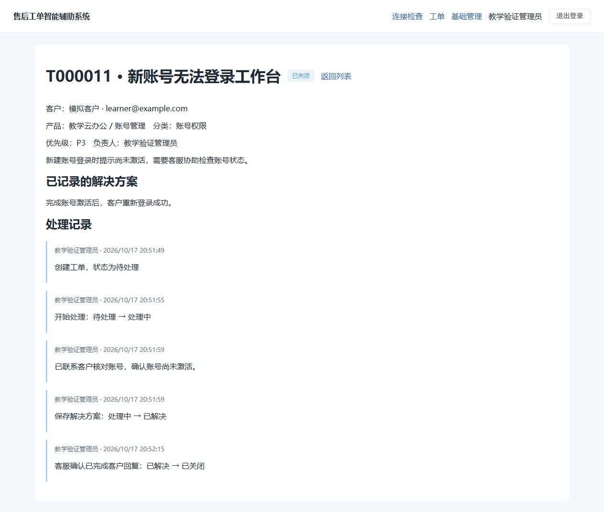

# 验证记录

> 本页保留此前交付时的验证记录。2026-10-24 修改后的验证范围与结果见[本轮修复记录](2026-10-24-教程修复.md)，不将历史结果视为本轮重新执行。

日期：2026-10-17。范围为本代码包的前三部分参考实现。
验证使用 WSL Ubuntu、Python 3.12.15、Node.js 24.22.0，以及独立的 PostgreSQL 18.6 临时数据库。
没有使用正式业务数据。

## 已执行的验证

| 项目 | 实际结果 |
|---|---|
| 第一部分健康接口 | HTTP 200，返回 {"status":"ok"} |
| 第一部分前端 | typecheck、build 通过 |
| 第二部分后端 | 7 项接口测试通过 |
| 第二部分前端 | typecheck、build 通过 |
| 第三部分后端 | 13 项接口测试通过 |
| 第三部分前端 | typecheck、build 通过 |
| Python 静态检查 | 第二、三部分 app/tests 的 Ruff 检查通过 |
| 数据库迁移 | 新数据库建表、第二部分升级第三部分通过；原有用户数保持一致 |
| 管理员初始化 | 命令行输入并创建管理员成功 |
| 本地配置生成 | 验证密码 URL 编码、随机签名密钥、测试配置、已有文件不覆盖、无凭据输出 |
| Vite 开发代理 | 实际请求可转发到 FastAPI |
| 浏览器业务流程 | 管理员登录、产品和模块创建、工单创建、开始处理、处理记录、解决、人工确认关闭成功 |
| 后端重启 | 实际停止再启动 Uvicorn，工单状态、解决方案和处理记录保持一致 |

后端测试还覆盖：错误密码、无效/过期令牌、客服越权、停用账号后拒绝旧令牌、
重复配置名冲突、禁止通过创建请求指定管理员角色、空方案/错误字段拒绝、
产品模块不匹配、配置停用后历史关联保留、新工单禁止使用停用项、分页筛选、
两个请求同时开始处理时只有一个成功、关闭后拒绝继续编辑。

## 浏览器验证截图

图中全部为本地验证使用的模拟数据。

## 已知限制

- 第二、三部分使用 Element Plus 全量注册，构建有大于 500 kB 的代码块提示；构建成功。
  当前保留直观的入门写法，按需加载和打包优化在后续有实际需求时处理。
- 本次验证覆盖当前功能；未进行生产部署、长时间压力测试或完整移动设备兼容性测试。
- PostgreSQL 验证使用隔离临时实例；教程中的 sudo 安装与系统服务操作需要你在本机执行。
- AI、OCR、Milvus 检索、系统邮件发送和离线模型评测属于后续阶段，未包含在本次完成结论中。
- 你手写进正式工程后，仍需在自己的文件与本地数据库上执行教程中的验收步骤。

## 2026-10-18 审查修正与复验

本次修复三个实际问题：管理员初始化校验错误可能在终端显示密码；登录校验响应携带原始密码输入；工单详情读取失败后仍出现可提交的编辑表单。现在输入错误保留字段与原因但不回显原始输入，编辑表单只在所需数据全部读取成功后显示。

同时修正各阶段讲解错位、.gitignore 来源说明，以及直接开始第三部分时遗漏的管理员初始化步骤。

| 本次实际执行 | 结果 |
|---|---|
| 第二部分完整后端测试 | 10 项通过 |
| 第三部分完整后端测试 | 16 项通过 |
| 两个阶段 Ruff 检查 | 通过 |
| 第三部分前端 typecheck、build | 通过；仍有原有大代码块提示 |
| 浏览器回归 | 读取失败无法提交；正常新建可填写；正常编辑显示原内容 |
| 逐文件教程核对 | 65 个代码块与源文件一致，标记沿用的文件一致 |

后端使用独立临时 PostgreSQL 数据库。浏览器回归使用模拟接口响应，专门控制读取失败场景；本次没有重复运行前述完整邮件外部确认流程，也没有修改你手写的正式工程。第一部分和第二部分前端未变动，表格上方对应结果是 2026-10-17 的验证记录。
