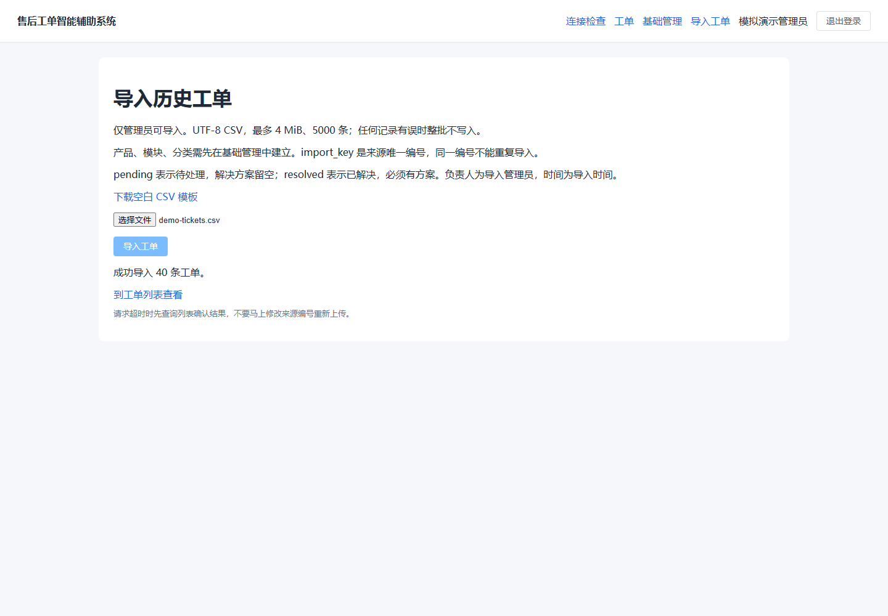
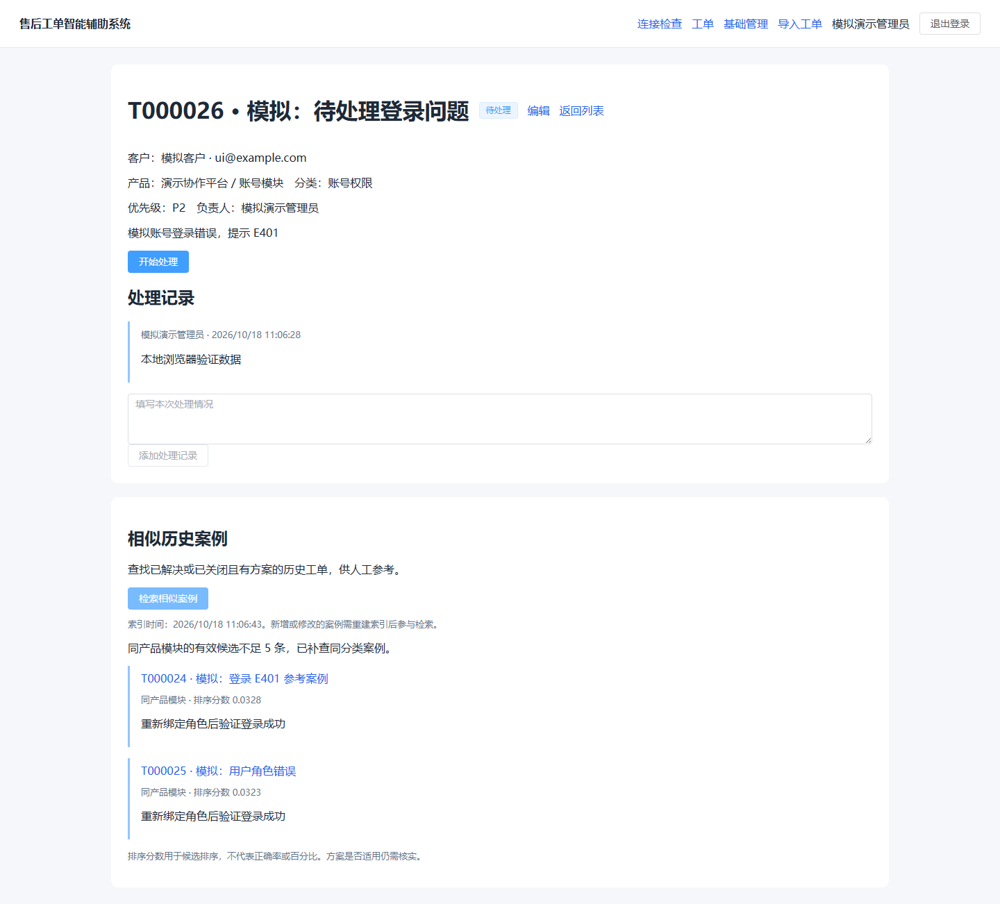

# 验证记录与未验证范围

> 本页保留此前交付时的验证记录。2026-10-24 修改后的验证范围与结果见[本轮修复记录](2026-10-24-教程修复.md)，不将历史结果视为本轮重新执行。

验证日期：2026 年 10 月 18 日。所有数据库操作使用隔离的临时 PostgreSQL 数据库，没有连接正式业务数据库。两个阶段均为独立参考代码，没有覆盖正式 backend/frontend。

## 自动检查

| 检查 | 第四部分 | 第五部分 |
|---|---|---|
| `python -m pytest -q` | 28 passed | 42 passed |
| `python -m ruff check app tests` | 通过 | 通过 |
| `python -m alembic check` | 无遗漏迁移 | 无遗漏迁移 |
| `npm run build`（包含 `npm run typecheck`） | 通过 | 通过 |

测试环境：WSL Ubuntu、Python 3.12.15、Node.js 24.22.0、PostgreSQL 18.6、PyMilvus 3.0.2、Milvus Lite 3.2.2、jieba 0.42.1。测试数据库名称以 `_test` 结尾；测试夹具拒绝连接不满足此规则的数据库。

前端仍有压缩后单个 JS 包超过 500 kB 的构建提示，构建退出码为 0。当前沿用已有 Element Plus 引入方式，本次没有顺手改造打包结构。

第四部分覆盖管理员权限、正常导入、UTF-8/列数/表头错误、记录限制、状态与方案约束、配置归属、重复编号以及整批不写入。第五部分还覆盖真实 Milvus 关键词和向量检索、筛选、跨进程持久化、模型配置一致性、失效候选过滤、排除自身、同分类补充和最多五条。

## 浏览器联调

使用 Chrome 自动操作真实 Vue 页面，连接真实 FastAPI、PostgreSQL 与 Milvus。Embedding 请求连接本地模拟 HTTP 服务；模拟服务返回固定四维向量，不具备真实语义能力。

1. 错误 CSV 表头在页面显示具体错误：通过。
2. 上传 40 条样例并保存到数据库：通过。
3. 再次上传同一文件，后端拒绝重复，页面显示原因：通过。
4. 工单详情查询相似案例，展示有效历史工单链接和方案：通过。
5. 在浏览器拦截一次请求并返回 503，确认显示索引错误且清空旧查询结果：通过。后端索引缺失逻辑另有自动测试覆盖。





另做过一次 3000 条模拟 CSV 的真实接口导入，成功写入临时 PostgreSQL；当次约 1.37 秒。这是本机的一次观察，不是性能承诺，也不是完整负载测试。

## 本次发现并修复的问题

同一进程中建索引再查询可以成功，但“单独命令建索引 → 启动后端 → 查询”曾报集合处于 released 状态。补充跨进程测试后，修复前确认失败；在查询前调用 `load_collection` 后，回归测试与浏览器联调均通过。

Embedding 响应在 HTTP 边界检查结构、条数、索引、维度、有限数值与非零向量；错误不返回默认成功或空向量。

## 未验证范围

- 未使用用户真实密钥调用远程 Embedding 服务，因此没有验证账号额度、地域匹配、远程延迟或真实语义效果。
- 未测独立评测集的 Recall@5 等指标；模板生成的模拟工单不能证明检索准确率。
- 未验证多进程共享 Milvus Lite，也不支持这种运行方式；目前要求单进程服务，停后端后重建索引。
- 没有发布到生产环境；知识文档、OCR、模型重排与建议生成不属于这两部分。

## 自己复查

沿用前三部分的独立测试数据库，在 `backend/.env.test` 中配置 `TEST_DATABASE_URL`，数据库名称必须以 `_test` 结尾。执行测试会创建测试数据，不要指向日常使用的数据库。

```bash
cd /mnt/e/oshino
source /mnt/e/xiangmu/.venv/bin/activate
cd backend
python -m pytest -q
python -m ruff check app tests
python -m alembic check
cd ../frontend
npm run typecheck
npm run build
```

`alembic check` 使用普通 `.env` 中的 `DATABASE_URL`，检查当前业务数据库是否与模型一致；先完成教程中的迁移。它与 pytest 使用的专用测试数据库配置不同。
