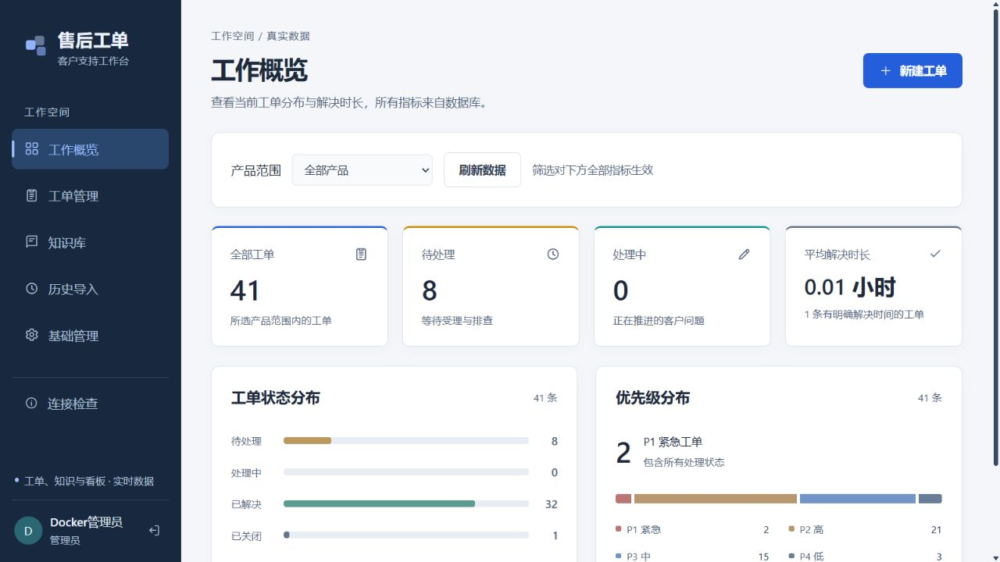

# 第七至九部分实施与验收

日期：2026-10-31。工程：`E:\oshino`，分支：`XM`。本轮未提交、推送或部署生产环境，保留原有修改和数据。

## 已实现内容

| 部分 | 本次实现 |
|---|---|
| 第七部分 | 双源检索、来源重排、结构化建议、引用快照、生成历史、人工编辑确认采用、来源原文预览 |
| 第八部分 | BM25 / dense / hybrid 案例检索对比、评测配置接口、评测 CLI、人工评分汇总及数据模板 |
| 第九部分 | 数据库真实统计、按产品筛选、状态和优先级分布、首次解决时间、平均时长及有效样本数 |

聊天使用单独的 OpenAI 兼容 API 配置；现有本地 Embedding 保持独立。没有填写 API 时明确提示缺少配置，不保存空建议或伪造成功记录。

建议只有人工勾选确认后才记录采用，不能自动发送邮件或改变工单状态。错误引用、重复采用、工单或来源变更、已关闭工单均有对应拒绝规则。等待聊天模型时释放数据库连接，完成后重新锁定和校验当前工单及来源。

看板一次聚合查询取得全部指标，避免统计卡片在并发更新时来自不同数据库快照。历史导入缺少可靠解决时间的案例不进入时长平均值；迁移只从既有明确解决状态记录回填。

## 实际验证

| 检查 | 结果及边界 |
|---|---|
| 后端完整回归 | `pytest -m "not live" -q`：87 项通过；使用临时隔离 PostgreSQL 数据库，测试后清理 |
| 聊天契约和业务 | 使用模拟外部响应；真实 PostgreSQL、Milvus、API 路由验证生成、人工采用、重复拒绝、过期拒绝、引用校验、关闭拒绝 |
| 上游错误 | 模拟 401、429、503 返回准确错误，只发一次请求，不自动重试 |
| 后端类型 | Pyright：0 errors、0 warnings |
| 本轮 Python 文件 | Ruff 检查通过 |
| 前端 | 9 项现有测试通过，`npm run build`（包含 typecheck）通过 |
| 数据库 | Docker 迁移头 `09_resolution_time`；`alembic check` 无新差异 |
| 容器 | `up -d --build --wait` 成功，数据库、后端、前端均 healthy |
| 真正检索链路 | 工单 41 的三种案例模式均返回结果，知识检索返回文档 1；本地索引仍为 33 条案例、4 个知识块 |
| 评测脚本 | 三种模式分别使用一个明确标记的功能冒烟样本实际运行成功；不作为论文独立评测成绩 |
| 页面 | 已登录打开看板、按产品筛选、打开工单、点击生成并核对配置缺失提示 |

构建仍提示存在超过 500 KB 的分包；构建成功不代表已完成首屏性能优化。

## 当前真实数据

全部 41 条工单：待处理 8、处理中 0、已解决 32、已关闭 1。优先级分布为 P1 2、P2 21、P3 15、P4 3。

全部产品有 1 条明确解决时间样本，平均 0.01 小时。筛选“演示协作平台”为 40 条工单，无可靠解决时间样本，正确显示“暂无样本”。这些是本地演示业务数据，不是毕业论文实验效果。

## 你接下来怎么验收

1. 打开 <http://127.0.0.1:18734/dashboard>，确认产品筛选、总数、分布和时长。
2. 按[第七部分配置说明](../01-教程/06-08-知识库与AI建议/07-AI处理建议.md)填写 `backend/.env.chat` 的三项配置，再重启 backend。
3. 打开待处理工单，生成建议、核对来源、编辑处理方案和回复草稿，勾选人工确认并保存。
4. 查看处理记录和生成历史，确认没有自动解决或发送邮件。
5. 按[第八部分教程](../01-教程/06-08-知识库与AI建议/08-整体验收与毕业设计材料.md)准备人工标注的独立评测集；运行脚本并实际评分。

## 尚未验证

真实聊天 API 尚未配置，因此服务商参数兼容性、真实模型生成质量、完整生成耗时和人工质量评分均未验证。没有写入虚构的论文指标。第十至十三部分不属于本轮实施范围。

## 教程同步修改

- 第七部分：聊天 API 与本地向量服务分开配置；移除百炼专属参数的旧说明。
- 第八部分：补充评测边界，修正 WSL 虚拟环境路径和数据库测试命令。
- 第九部分：沿用浅色工作台，真实统计替换内存演示，不编造缺失解决时间。
- 同步相关逐文件代码、README、文档入口和 Docker 配置说明。
